<h1 align="left">Hey There 👋 What's up?</h1>

  👨‍🎓 My name is João Victor and I'm a 19 year old student from Brazil studying Information Systems.  
  🚀 My goal is to get in Web Development area.  
  👨‍💻 I'm chasing for my first oportunity to work with web development!

<h2 align="left">About me</h2>

###

  💻 As an <strong>Information Systems</strong> student at <strong>CESMAC</strong>, I am a developer focused on creating modern, responsive, and functional web interfaces through practical and academic projects.  
  🚀 I enjoy exploring web technologies and crafting intuitive user experiences, focusing on writing clear, efficient, and maintainable code that works seamlessly across different devices.  
  📚 Currently, I am deepening my knowledge in UI/UX best practices alongside core computer science foundations—such as object-oriented programming, data structures, and database systems—to build complete and scalable web applications.  
  🌱 I strongly believe in continuous learning and am always looking for opportunities to grow as a developer and expand my portfolio.  
  🌍 Outside of coding, I enjoy keeping up with web design and technology trends, studying English, and exploring topics that help me grow both personally and professionally.

###

<h2 align="left">Technologies & Tools</h2>

###

  

###

<h2 align="left">Featured Projects</h2>

###

  🍔 <strong><a href="https://github.com/JoaoVictor5626/herosfoodmcz" target="_blank">Heros Food Mcz</a></strong> (<a href="https://herosfoodmcz.vercel.app/" target="_blank">Live Site 🔗</a>) — Responsive landing page for a local burger shop in Maceió-AL, built with HTML5, CSS3, and Vanilla JavaScript as part of CESMAC's <em>Impulso Web</em> extension project.  
  ♿ <strong><a href="https://github.com/JoaoVictor5626/sistema-de-apoio-e-acessibilidade" target="_blank">Sistema de Apoio e Acessibilidade</a></strong> — Web system focused on digital inclusion, providing adapted resources and information for different accessibility needs. Built with Node.js, Express, EJS, and MongoDB.  
  🎓 <strong><a href="https://github.com/JoaoVictor5626/pojae" target="_blank">POJAE</a></strong> — Internship and Young Apprentice Opportunity Platform developed for CESMAC, integrating Software Engineering practices with a Java backend and HTML, Tailwind CSS, and JavaScript frontend to connect students with companies.

###

<h2 align="left">Contact with me</h2>

###

  
   
  

###

###

  
  

###
